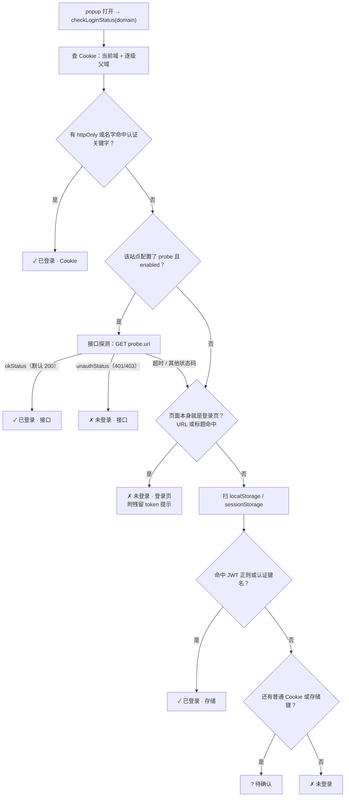
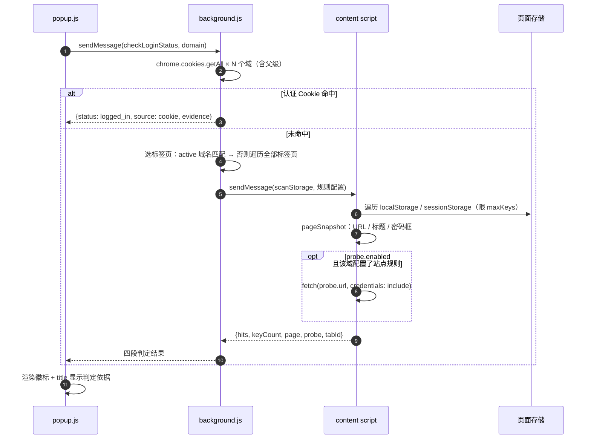
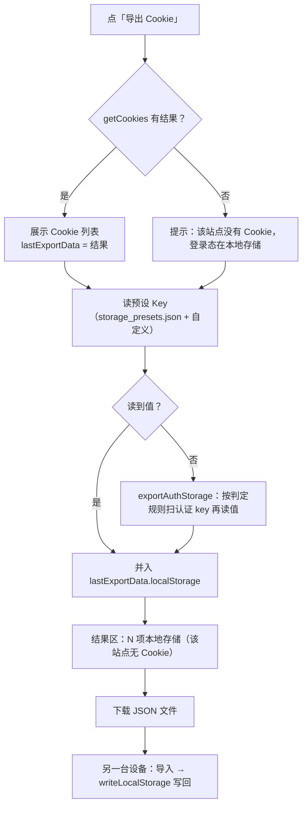

# 登录状态判定设计（login_detect.json v2）

> 适用范围：popup 顶部「已登录 / 未登录 / 待确认」徽标，以及依赖该判定的**导出兜底**逻辑。
> 代码：`src/background.js`（`checkLoginStatus` / `exportAuthStorage`）、`src/content.js`（`scanStorage` / `pageSnapshot` / `probeLogin`）、`src/popup/popup.js`
> 规则：`src/login_detect.json`（改规则不用改代码）

---

## 1. 要解决的问题

v1.6.10 的判定只有一句：`chrome.cookies.getAll` 返回 0 条 → 未登录。

这在两类站点上必然误判：

| 站点类型 | 认证载体 | 现象 |
|---|---|---|
| Bearer Token 型（Vue/React 后台） | `localStorage` 里的 JWT，请求头 `Authorization: Bearer ***` | Cookie 为 0，永远显示「未登录」 |
| CAS / OAuth 跨域 SSO | 票根在 SSO 域，业务域可能不落 Cookie | 同上，且导出被 `if (!result.success) return "请先登录"` 直接拦死 |

同一个「没有 Cookie = 未登录」的错误假设还写在**导出流程**和**帮助文档**里，所以只改徽标等于只修了三分之一。

---

## 2. 判定总流程

## 3. 优先级与理由

| 顺序 | 依据 | 结果 `source` | 为什么排在这 |
|---|---|---|---|
| ① | 认证 Cookie（httpOnly 或关键字） | `cookie` | 最强且零成本；大多数 OA/企业系统属于这一类 |
| ② | 接口探测 | `probe` | 唯一能反映**服务端**真实会话的手段；但要按站点配置，故默认关闭 |
| ③ | 登录页特征 | `login-page` | 只在**没有**认证 Cookie 时生效：token 过期后 localStorage 常残留旧 JWT，页面已回登录页才是真相 |
| ④ | 认证存储（JWT / 关键字） | `storage` | 覆盖 Bearer Token 型站点（本次主场景） |
| ⑤ | 只剩普通 Cookie / 存储 | — (`maybe`) | 不谎报已登录；徽标显示「? 待确认」，悬停给出数量 |
| ⑥ | 两处皆空 | — | 真正未登录 |

> ③ 放在 ④ 之前是刻意的：**页面状态优先于残留凭据**。

## 4. 调用时序

## 5. 导出 / 导入兜底

导入端 `writeLocalStorage` 原本就存在，因此本次只补了导出侧，链路即闭环。

## 6. 规则文件字段

`src/login_detect.json`

| 段 | 字段 | 说明 |
|---|---|---|
| `cookie` | `authNameKeywords` | Cookie 名包含任一关键字即视为认证 Cookie |
| | `ignoreNameKeywords` | 统计类噪音（`_ga`、`hm_`、`lang`…），不参与判定 |
| | `parentDomainEscalate` | 是否向父域逐级查询（`.example.com`） |
| `storage` | `scanAreas` | 扫描区域，默认 localStorage + sessionStorage |
| | `authKeyKeywords` | 键名关键字（`token`、`jwt`、`presist`…） |
| | `jwtPattern` | 值里的 JWT 形态正则（快速命中） |
| | `ignoreKeyKeywords` | UI 尺寸、主题、语言等噪音键 |
| | `maxKeys` / `maxValueChars` | 扫描上限，避免大站点卡顿 |
| `loginPage` | `urlPatterns` / `titlePatterns` | 命中即认为当前页是登录页 |
| | `ignoreUrlPatterns` | 白名单排除（如 `/loginlog`） |
| `probe` | `enabled` | 总开关，默认 false |
| | `sites.<domain>.url` | 「当前用户」类接口路径 |
| | `sites.<domain>.okStatus` / `unauthStatus` | 判已登录 / 未登录的状态码 |
| `verdict` | `loginPageOverridesStorage` | 登录页特征是否压过存储命中，默认 true |

## 7. 边界与已知限制

| 情况 | 现象 | 处理 |
|---|---|---|
| token 只存在内存（Vuex 未持久化） | 判定不到 | 限制：content script 在隔离世界，读不到页面 JS 变量；只能靠 Cookie 或 probe |
| 凭据存 IndexedDB | 判定不到 | 明确不做：异步遍历成本高、企业后台极少用；如遇实际站点再评估 |
| 页面有多个标签页 | 需选对标签页 | 先看 active 的主机名是否匹配，否则遍历全部标签页匹配（**不能**用 `chrome.tabs.query({url:['*://*.IP/*']})`，IP 会被判非法 match pattern） |
| 站点 URL 里本身含 `login` | 误判为登录页 | 用 `loginPage.ignoreUrlPatterns` 排除 |
| 站点 URL 含 `login` 的合法业务页很多 | 易误判 | 只在无认证 Cookie 时才采用该信号；必要时把该站点加进 ignore 列表 |
| popup 打开时活动页不是目标站 | 扫错页面 | 已按域名选标签页 |
| 徽标不自动刷新 | 换页面后仍是旧状态 | 设计如此：popup 每次打开查询一次 |

## 8. 自测用例

Kali `192.168.3.17` + Chromium 149 headless + CDP 直连（无需 chromedriver，`--remote-allow-origins=*` 必加）。

| # | 用例 | 期望 |
|---|---|---|
| ① | localStorage 写入 JWT，无 Cookie | `logged_in` / `storage` |
| ② | 登录页（URL 含 `login` + 密码框 + 残留 JWT） | `logged_out` / `login-page`，带 `stale` |
| ③ | 存储与 Cookie 皆空 | `logged_out` |
| ④ | 写入 HttpOnly Cookie | `logged_in` / `cookie` |
| ⑤ | 配置 probe（测试用 `okStatus:[404]`） | `logged_in` / `probe` |
| ⑥ | 无 Cookie 站点点「导出」 | 结果区出现「N 项本地存储（该站点无 Cookie）」 |

完整脚本思路见技能 `sessionmaster-plugin/references/login-status-detection.md`。

## 9. 变更记录

| 版本 | 变更 |
|---|---|
| v1.6.10 | 新增登录状态指示器（只看 Cookie） |
| v1.6.11（待发） | 四段判定 + 规则外置 `login_detect.json` + 导出兜底 `exportAuthStorage` + 帮助文档/FAQ 同步 |
